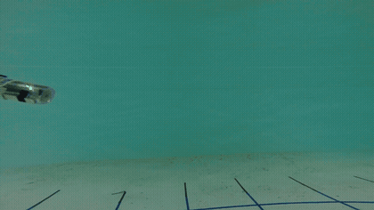
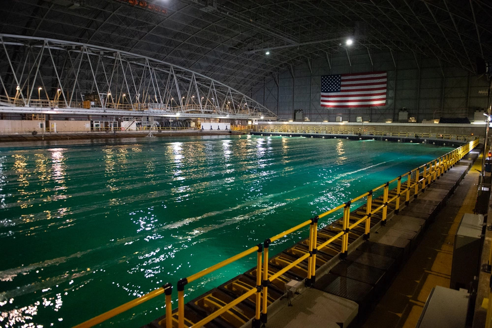

# Seaglider

A student-built miniature underwater glider based on the **SeaGlide** design from RoboNation (<https://seaglide.org/>), with firmware that holds a target depth using a pressure sensor and a PID controller.



*SeaGlide demo, one-yo glide at 5 ft depth. Video: RoboNation / SeaGlide, [vimeo.com/seaglide](https://vimeo.com/seaglide). [Full video](media/seaglide_one-yo_5ft_depth_720p.mp4).*

## How a seaglider works

A glider has no propeller. It changes its buoyancy by taking in or pushing out water, so it alternately sinks and rises. Its wings turn that vertical motion into forward motion. Full-size gliders use the same idea to stay deployed for months and collect ocean data. SeaGlide is a high-school-scale version, and it can log temperature and pressure as it flies. More at <https://seaglide.org/>.

In this glider a continuous-rotation servo moves a plunger and counterweight. Moving the plunger changes how much water the hull holds, and with it the buoyancy.

## Testing

The glider was tested in a pool and at Carderock.



The 2024 tests used a timed dive/rise cycle, in which the plunger ran for fixed times.

## Firmware

`firmware/seaglider_depth_pid.ino` is the final depth-control firmware. It started from the SeaGlide starter firmware ([seaglide.org/firmware](https://seaglide.org/firmware)) and adds closed-loop depth control in place of fixed timings.

### What was added to the starter code

- Depth from a pressure sensor, zeroed at the surface by averaging 20 readings.
- A spike-rejecting low-pass filter on depth, and a filtered vertical-speed estimate.
- A PID loop on depth, with anti-windup and a depth deadband.
- Plunger homing to the dive limit switch at start-up, with a timeout.
- An estimate of plunger position, by timing the servo and re-zeroing at the limit switch.
- Safety overrides: rise if depth exceeds `MAX_DEPTH_M` or the sensor stops responding.
- CSV logging over serial for plotting.

### Control design

A continuous-rotation servo sets plunger **speed**, but buoyancy depends on plunger **position**. Feeding a depth PID straight into servo speed puts two integrators between the controller and the depth, which tends to oscillate. In a toy buoyancy model, that arrangement never settled. So the loop is cascaded:

1. **Outer loop:** PID on depth gives a desired plunger position, which is a buoyancy setting. The derivative acts on the measurement, and the integral term is only accumulated when the output is not saturated.
2. **Inner loop:** a proportional controller turns the position error into a servo speed, and stops inside a small deadband.

### Hardware

| Part | Connection |
|---|---|
| Continuous-rotation servo (plunger and counterweight) | Pin 10 |
| Dive limit switch | Pin 11, `INPUT_PULLUP`, reads LOW when pressed |
| Pressure sensor | I2C |

Servo convention: 90 is stopped, below 90 is dive (take in water), above 90 is rise (push out water).

### Sensor

The sensor is chosen by one line at the top of the sketch:

| `SENSOR` | Library | Use |
|---|---|---|
| `SENSOR_BMP280` (default) | Adafruit BMP280 and Adafruit Unified Sensor | Bench tests only. **Not waterproof.** |
| `SENSOR_MS5837` | Blue Robotics MS5837 | Underwater. Set the model to match your sensor (`MS5837_30BA` for the Bar30, `MS5837_02BA` for the Bar02). |

`Wire` and `Servo` ship with the Arduino IDE. Set `FLUID_DENSITY` to about 997 for fresh water or 1025 for seawater.

### Calibrate before a run

These constants depend on your build. The defaults are placeholders.

| Constant | How to set it |
|---|---|
| `TRAVEL_MS` | Time the plunger takes to go end to end at full servo speed. |
| `SERVO_MIN_MOVE` | Smallest deflection from 90 that actually turns your servo. |
| `NEUTRAL_MS` | Plunger position where the glider floats neutrally. Start at mid-travel; the integral term trims the error. |
| `KP_MS_PER_M`, `KI_MS_PER_MS`, `KD_MS_PER_MPS` | Tune in the water. Raise `KD` if it overshoots, raise `KP` if it is slow to reach depth. |
| `MAX_DEPTH_M` | Keep it below your hull and sensor rating. |

The plunger position estimate assumes servo speed is proportional to deflection. Many servos saturate well before full deflection, so check this against a stopwatch.

### Serial log

115200 baud, one line per 100 ms:

`time_ms, pressure_pa, depth_m, vel_mps, error_m, target_ms, plunger_ms, servo_cmd, flags`

`flags` is 0 normally, 1 when the max-depth override is active, 2 when the sensor has timed out.

## Verification

The control logic has been run in a host-side simulation against a toy buoyancy model (`sim/`). The model is not measured from this glider. In it the glider reached and held the target depth with some initial overshoot, ignored a short 2.5 m pressure glitch, and triggered the max-depth rise. Gains are starting values and have not been tuned on the real glider.

To rerun it, you need `g++`:

```bash
cd sim
./run.sh          # summary
./run.sh spike    # with a pressure glitch
./run.sh x log    # print the CSV log
```

## Repository layout

| Path | Contents |
|---|---|
| `firmware/seaglider_depth_pid.ino` | Depth-control firmware |
| `sim/` | Host-side simulation harness and Arduino mocks |
| `media/` | SeaGlide demo video and preview GIF |
| `images/` | Carderock photo |

## Credits

- SeaGlide design, kit, starter firmware and demo video: RoboNation, Inc. — <https://seaglide.org/>, <https://vimeo.com/seaglide>
